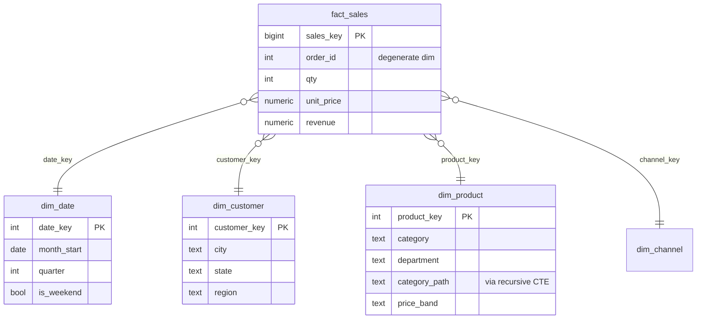

# Retail Dimensional Model + Window Function Report + CTE MoM Growth

[](https://colab.research.google.com/github/ojaswip2828/sql-de-projects/blob/main/week5-retail-dimensional-model/Week5_Dimensional_Model_Window_Report.ipynb)

> **SQL Track · Week 5 mini project (Intermediate + Advanced)**
> Takes a messy flat order export, normalizes it to 3NF, builds a star schema on top, and produces an analytics report with window functions, CTE-based month-over-month growth, subtotals, and materialized views — all on a real PostgreSQL 16 server running inside Google Colab.

---

## Problem

An omni-channel retailer (Web / App / Store, 11 Indian cities, 20 SKUs) exports orders as one flat file with the basket packed into a single text column (`SKU-05x1;SKU-12x3`). Analysts can't query it reliably, and leadership wants a monthly growth report.

**Goal:** turn the export into a clean OLTP model and an analytics-ready star schema, then answer the business questions in SQL.

## Pipeline

```
orders_flat (0NF)  ──split──▶  order_lines_1nf  ──decompose──▶  oltp.* (3NF)  ──denormalize──▶  dw.* (star)  ──▶  report + views
```

## Data model

**3NF (OLTP):** `regions ─< states ─< cities ─< customers ─< orders ─< order_items >─ products >─ categories (self-referencing hierarchy)`

**Star schema (analytics):**



Grain: **one row per order line**.

## Topics covered

| Section | What it does | SQL concepts |
|---|---|---|
| 2. Normalization | Explodes the basket, proves functional dependencies with `GROUP BY … HAVING`, decomposes to 3NF, verifies the decomposition is lossless with `EXCEPT` | 1NF, 2NF, 3NF, `string_to_array`, `LATERAL` |
| 3. Star schema | Date dimension from `generate_series`, product hierarchy flattened with a recursive CTE, surrogate keys | Dimensional modeling, `WITH RECURSIVE` |
| 4. Subqueries | Product revenue vs average, unusually large orders, cross-department buyers, customers who bought *every* Home product, churn detection, cohort retention | Scalar, correlated, `EXISTS` / `NOT EXISTS`, relational division, `UNION` / `INTERSECT` / `EXCEPT` |
| 5. Window report | Tie behaviour, top-N per group, previous/next month, running total, moving average, 7-day rolling window, LTV quartiles, purchase frequency | `ROW_NUMBER`, `RANK`, `DENSE_RANK`, `LAG`, `LEAD`, `NTILE`, `ROWS` vs `RANGE` frames |
| 6. MoM growth | Chained CTEs for MoM + YoY, recursive month spine so months with zero sales are not skipped, best/worst growth month per department | CTEs, recursive CTE, `NULLIF` |
| 7. Subtotals | Region × department subtotals, channel × price-band cube, custom groupings | `ROLLUP`, `CUBE`, `GROUPING SETS`, `GROUPING()` |
| 8. Views | Enriched view, monthly materialized view, staleness demo, `REFRESH … CONCURRENTLY`, speed comparison | `VIEW`, `MATERIALIZED VIEW` |
| 9. Executive report | Region × month revenue, MoM %, 3-month moving average, rank in month, top product, plus charts | Everything combined |
| 10. Self-test | Predict-the-output questions + one query to write | Week-5 test format |

## Key results

Values are from one run; data is seeded, so reruns give the same or very close numbers.

- **Normalization:** 3,500 orders → 6,536 order lines. All five functional dependencies hold, and the 3NF tables join back to the 1NF data with **0 differences** (lossless).
- **Redundancy removed:** in 1NF each customer's details were repeated ~16× on average.
- **Recursive month spine:** found **8 region × department × month cells with zero sales** that a plain `GROUP BY` would have silently skipped, which would have made `LAG()` compare against the wrong month.
- **Materialized view:** about **10× faster** than the equivalent view for the department rollup (exact timing depends on hardware).

## How to run

1. Click **Open in Colab** above (or upload the `.ipynb` to [colab.research.google.com](https://colab.research.google.com)).
2. `Runtime → Run all`.
   - The first cell installs **PostgreSQL 16** from the official PGDG repo (~60–90 s).
   - Every later cell is plain SQL sent through a small `sql()` helper that returns a pandas DataFrame.
3. The notebook is **idempotent**: rerunning drops and rebuilds the schemas.

**Running locally:** skip the first cell, point the `_connect()` helper at your own PostgreSQL ≥ 15 instance, and run the rest.

## Repo structure

```
week5-retail-dimensional-model/
├── Week5_Dimensional_Model_Window_Report.ipynb
└── README.md
```

## Interview talking points

- **Why denormalize after normalizing?** 3NF protects writes from update anomalies. A star schema cuts joins and gives analysts readable attributes. Each layer has its own job.
- **`RANK` vs `DENSE_RANK`:** with ties of 1,1 the next value is 3 with `RANK` and 2 with `DENSE_RANK`. Use `DENSE_RANK` when you need "top 3 distinct values".
- **The default window frame trap:** with `ORDER BY`, the default frame is `RANGE … CURRENT ROW`, so tied rows are summed together. Use `ROWS` for a true running total.
- **Why a month spine?** `LAG()` looks at the previous *row*, not the previous *month*. Missing months produce wrong MoM numbers with no error.
- **`GROUPING()` vs `IS NULL`:** real data can contain NULLs. `GROUPING()` is the only reliable way to tell which rows are subtotals.
- **When to use a materialized view:** for expensive aggregates read far more often than the data changes. You must own the refresh, and `CONCURRENTLY` needs a unique index.

## Tech

PostgreSQL 16 · Python 3 · psycopg2 · pandas · matplotlib · Google Colab
